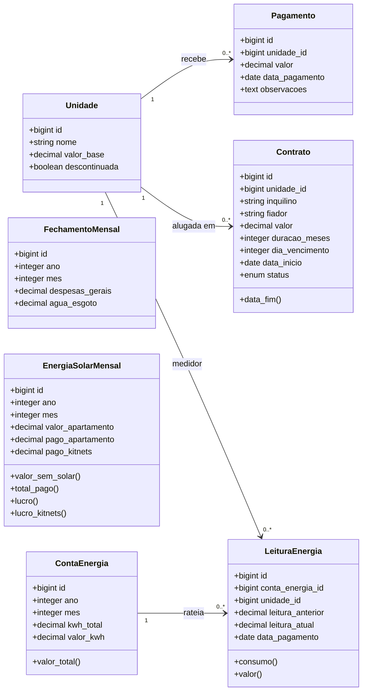

# Kitnet

Sistema web para a gestão financeira de 12 kitnets de aluguel: pagamentos recebidos, custos do mês, conta de energia com medidores por kitnet e o lucro da energia solar.


## Índice

- [Funcionalidades](#funcionalidades)
- [Tecnologias](#tecnologias)
- [Modelo de dados](#modelo-de-dados)
- [Regras de negócio](#regras-de-negócio)
- [Começando](#começando)
- [Uso](#uso)
- [Qualidade e segurança](#qualidade-e-segurança)
- [App Android](#app-android)
- [Backup](#backup)
- [Deploy](#deploy)

## Funcionalidades

- **Pagamentos**: os aluguéis recebidos no mês, por kitnet, com quem já pagou e quem falta entre as kitnets com valor base; cada pagamento tem valor (sugerido pelo valor base da kitnet), data e observações
- **Contratos**: quem aluga cada kitnet — inquilino, fiador (opcional), valor (sugerido pelo valor base), duração em meses, dia de vencimento, início (opcional) e situação `ativo` ou `finalizado`. Independentes dos pagamentos: não geram cobranças
- **Ocupação**: as kitnets ocupadas (com inquilino, valor e vencimento) e as livres, pelos contratos ativos
- **Kitnets**: as 12 kitnets fixas, por andar, mais a antiga casa (descontinuada, para os pagamentos do passado), com valor base e o histórico de pagamentos de cada uma
- **Finanças** (página inicial): visão anual (resultado, recebido, custos e energia solar do ano escolhido) e o resultado de cada mês; por mês, lança despesas gerais e água e esgoto e soma o lucro da energia solar para chegar ao resultado
- **Energia**: conta de energia do mês (kWh total e tarifa do kWh; o valor total é calculado) e, por kitnet, a leitura do medidor, o consumo, o valor a cobrar e se já foi pago
- **Energia solar**: quanto a energia custaria sem os painéis (conta das kitnets + apartamento), menos o que foi realmente pago; mostra o lucro da energia solar das kitnets e o lucro total do mês
- Interface responsiva com modo escuro; no celular, navegação na barra de baixo (como num app)

## Tecnologias

| Camada         | Ferramenta                                  |
| -------------- | ------------------------------------------- |
| Linguagem      | Ruby 3.4.10                                 |
| Framework      | Rails 8.1                                   |
| Banco de dados | SQLite                                      |
| Frontend       | Hotwire (Turbo + Stimulus), Importmap       |
| Estilo         | Tailwind CSS                                |
| Infra Rails    | Solid Queue, Solid Cache, Solid Cable       |
| Deploy         | Kamal + Thruster (Docker)                   |

## Modelo de dados



> Todas as tabelas também possuem `created_at` e `updated_at`. `FechamentoMensal` guarda os custos lançados em cada mês da página Finanças, e `ContaEnergia` e `EnergiaSolarMensal` os valores de energia; todos têm um registro por ano e mês.

## Regras de negócio

- **Kitnets são fixas**: as 12 (`001`–`004`, `101`–`104`, `201`–`204`) e a **Antiga casa** vêm do seed; no app só se altera o valor base. A Antiga casa é `descontinuada`: não é mais alugada, aceita pagamentos com datas do passado, aparece separada no quadro e some das telas mensais depois do mês do último pagamento.
- **Contrato** exige inquilino, kitnet, valor maior que zero, duração de 1 a 120 meses e dia de vencimento de 1 a 31; fiador e início são opcionais (com início, o fim é calculado). **Cada kitnet só pode ter um contrato ativo**; finalizar o contrato deixa a kitnet livre na Ocupação. Contratos não criam nem alteram pagamentos.
- **Pagamento** pertence a uma kitnet e tem valor maior que zero e data de pagamento obrigatória, que não pode ser no futuro. O valor vem preenchido com o valor base da kitnet e pode ser ajustado.
- **Pagamentos do mês**: uma kitnet conta como paga no mês se tiver ao menos um pagamento com data naquele mês; "faltam pagar" lista as kitnets **com valor base** sem pagamento (kitnet sem valor base não é cobrada).
- **Energia**: a tarifa do kWh é digitada (sem o desconto da energia solar) e o valor total da conta = kWh total × tarifa; consumo da kitnet = leitura atual − leitura anterior (que vem do mês passado); valor da kitnet = consumo × valor do kWh. A diferença entre a conta e a soma dos medidores aparece como áreas comuns e perdas.
- **Lucro total da energia solar** = (conta das kitnets pela tarifa + energia do apartamento) − (conta paga do apartamento + conta paga das kitnets).
- **Lucro da energia solar das kitnets** = conta das kitnets pela tarifa − conta paga das kitnets. É este valor que entra em Finanças na coluna Energia solar.
- **Resultado do mês** (Finanças) = recebido + energia solar − despesas gerais − água e esgoto. Os custos não podem ser negativos.

## Começando

### Pré-requisitos

- Ruby 3.4.10
- SQLite 3
- Bundler

### Instalação

```bash
git clone https://github.com/keandro/kitnet.git
cd kitnet
bin/setup
```

O `bin/setup` instala as dependências, prepara o banco de dados e inicia o servidor. Para apenas preparar o ambiente sem subir o servidor:

```bash
bin/setup --skip-server
```

### Dados iniciais

O seed cria as 12 kitnets (`001`–`004`, `101`–`104`, `201`–`204`) e a Antiga casa:

```bash
bin/rails db:seed
```

## Uso

Inicie o servidor de desenvolvimento (Rails + watcher do Tailwind):

```bash
bin/dev
```

Acesse <http://localhost:3000>. Não há login: o app é feito para uso pessoal na rede de casa, e qualquer aparelho na mesma rede consegue abri-lo.

| Rota             | Descrição                         |
| ---------------- | --------------------------------- |
| `/`              | Abre Finanças                     |
| `/pagamentos`    | Pagamentos do mês                 |
| `/contratos`     | Contratos (ativos e finalizados)  |
| `/ocupacao`      | Kitnets ocupadas e livres         |
| `/kitnets`       | Kitnets e histórico de pagamentos |
| `/financas`      | Finanças por ano                  |
| `/energia`       | Conta de energia e medidores      |
| `/energia-solar` | Lucro da energia solar            |
| `/backup`        | Exportar, importar e cópias       |
| `/up`            | Health check                      |

## App Android

A pasta `android/` tem um app Android (WebView) que abre o sistema com o mesmo layout do navegador do celular, em tela cheia, com ícone próprio. Ele não guarda dados: só funciona com o servidor rodando no computador e o celular no mesmo Wi-Fi.

### Como baixar o APK

O APK é gerado pelo GitHub Actions e fica disponível por 30 dias em cada execução.

**Pelo site do GitHub** (precisa estar logado):

1. Abra a aba [**Actions**](https://github.com/keandro/kitnet/actions/workflows/android.yml) do repositório, no workflow **Android APK**.
2. Clique na execução mais recente com ✓ verde.
3. No fim da página, em **Artifacts**, baixe **lf-kitnets-apk**. Vem um `.zip`; dentro dele está o `app-release.apk`.

**Pelo terminal**, com o [GitHub CLI](https://cli.github.com/):

```bash
gh run download -R keandro/kitnet -n lf-kitnets-apk -D ~/Downloads/lf-kitnets-apk
```

Se a última execução já passou dos 30 dias, gere um APK novo em *Actions → Android APK → Run workflow*.

### Como instalar no celular

1. Passe o `app-release.apk` para o celular (cabo USB, Google Drive, WhatsApp para você mesmo…).
2. Toque no arquivo no celular. O Android pede para permitir **instalar apps desconhecidos** a partir do app que abriu o arquivo; permita.
3. Confirme a instalação. O app **LF Kitnets** aparece com o ícone da casinha.

Para atualizar, instale o APK novo por cima: o endereço do servidor salvo continua.

### Como funciona

- **Endereço do servidor:** começa em `http://192.168.18.204:3000`. Se o servidor não responder (computador desligado, celular fora do Wi-Fi de casa ou IP do computador mudou), o app mostra uma tela para corrigir o endereço, que fica salvo no celular. Fixe o IP do computador no roteador para não precisar mudar.
- **Navegação:** o botão voltar do Android volta de página, puxar para baixo no topo da página atualiza e o modo claro/escuro segue o celular.
- **Gerar o APK:** o workflow `.github/workflows/android.yml` compila e assina o APK a cada push que mexe em `android/`, ou manualmente em *Actions → Android APK → Run workflow*.
- **Assinatura:** a chave fica fora do repositório (`~/.config/lf-kitnets/`) e no GitHub como os segredos `KEYSTORE_BASE64` e `KEYSTORE_PASSWORD`. Guarde uma cópia dela: sem a mesma chave, o celular não aceita atualizar o app (seria preciso desinstalar e instalar de novo).

## Qualidade e segurança

```bash
bin/rubocop          # lint
bin/brakeman         # análise estática de segurança
bin/bundler-audit    # vulnerabilidades em gems
bin/importmap audit  # vulnerabilidades em pacotes JS
```

Esses mesmos passos rodam no GitHub Actions a cada push na `main` e em pull requests (`.github/workflows/ci.yml`).

## Backup

Todos os dados ficam num único arquivo SQLite (`storage/development.sqlite3`). A página **Backup** (`/backup`) cuida das cópias:

- **Exportar:** baixa uma cópia completa e consistente do banco, feita com o app rodando. Guarde num pendrive ou na nuvem.
- **Importar:** restaura um backup exportado antes e **substitui todos os dados atuais**. Antes de trocar, o sistema guarda uma cópia do banco atual (`antes-importacao-…`). Só aceita bancos do LF Kitnets; backups de versões anteriores do app são atualizados (as migrações que faltam rodam na importação).
- **Cópias guardadas no computador:** ficam em `storage/backups/` (fora do git). Um backup automático (`auto-AAAA-MM-DD`) é feito por dia, no primeiro acesso, e os últimos 15 ficam guardados. Cada cópia pode ser baixada pela página.

Sem o app, dá para copiar o banco pelo terminal:

```bash
sqlite3 storage/development.sqlite3 ".backup 'kitnet-$(date +%F).sqlite3'"
```

## Deploy

O projeto está configurado para deploy com [Kamal](https://kamal-deploy.org) usando a imagem definida no `Dockerfile`:

```bash
bin/kamal setup   # primeiro deploy
bin/kamal deploy  # deploys seguintes
```

As configurações ficam em `config/deploy.yml` e os segredos em `.kamal/secrets`.
