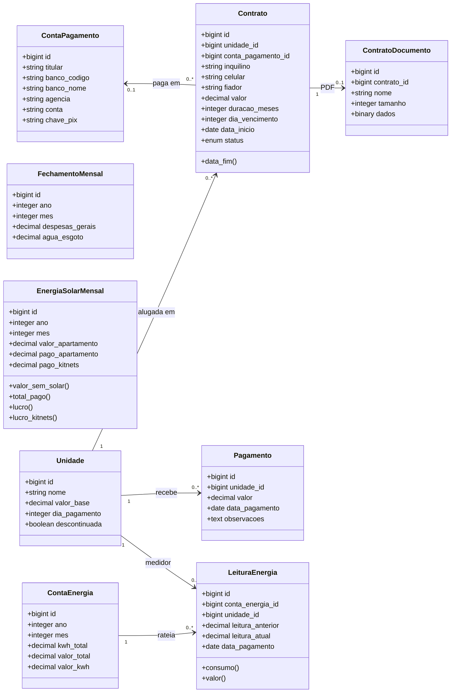

# Kitnet

Sistema web para a gestão financeira de 12 kitnets de aluguel: pagamentos recebidos, custos do mês, conta de energia com medidores por kitnet e o lucro da energia solar.


## Índice

- [Funcionalidades](#funcionalidades)
- [Tecnologias](#tecnologias)
- [Modelo de dados](#modelo-de-dados)
- [Regras de negócio](#regras-de-negócio)
- [Começando](#começando)
- [Uso](#uso)
- [Qualidade e segurança](#qualidade-e-segurança)
- [Rodando no Windows](#rodando-no-windows)
- [App Android](#app-android)
- [Backup](#backup)
- [Deploy](#deploy)

## Funcionalidades

- **Pagamentos**: os aluguéis recebidos no mês, por kitnet, com quem já pagou e quem falta entre as kitnets com valor base; cada pagamento tem valor (sugerido pelo valor base da kitnet), data (sugerida pelo dia do pagamento da kitnet) e observações
- **Contratos**: quem aluga cada kitnet — locatário (nome, celular para WhatsApp, CPF, RG, nacionalidade, estado civil e profissão), fiador (opcional, com os mesmos dados e endereço), valor (sugerido pelo valor base), duração em meses, dia de vencimento, início (opcional), situação `ativo` ou `finalizado`, a conta para pagamento (uma das Contas para pagamento) e o contrato em PDF (opcional, até 20 MB). Independentes dos pagamentos: não geram cobranças
- **Contrato para assinar**: gera o PDF do contrato de locação (modelo das kitnets) com os dados do locatário, fiador, valor e prazo por extenso; a forma de pagamento sai da conta para pagamento escolhida no contrato; os dados fixos (locador, imóvel, foro, taxa de limpeza) ficam em *Contratos → Modelo do contrato*, no banco, fora do código. Lá também se edita o texto inteiro do contrato (títulos, cláusulas renumeradas sozinhas, negrito/sublinhado, campos como `{locatario}` e trechos que só entram com fiador ou taxa de limpeza), com PDF de exemplo e botão para voltar ao texto original (`config/contrato_padrao.txt`)
- **Contas para pagamento**: as contas onde os locatários pagam — nome da conta (titular), banco com código e nome (o nome se completa pelo código), agência, conta e chave Pix, com botão para copiar a conta e a chave
- **Ocupação**: as kitnets ocupadas (com locatário, valor e vencimento) e as livres, pelos contratos ativos
- **Kitnets**: as 12 kitnets fixas, por andar, mais a antiga casa (descontinuada, para os pagamentos do passado), com valor base, dia do pagamento e o histórico de pagamentos de cada uma (o lápis do quadro edita o valor base e o dia ali mesmo)
- **Finanças** (página inicial): visão anual (resultado, recebido, custos e energia solar do ano escolhido) e o resultado de cada mês; por mês, lança despesas gerais e água e esgoto e soma o lucro da energia solar para chegar ao resultado
- **Energia**: conta de energia do mês (kWh total e valor total; o valor do kWh é calculado) e, por kitnet, a leitura do medidor, o consumo, o valor a cobrar e se já foi pago; um botão manda a conta de cada kitnet pelo WhatsApp para o locatário do contrato ativo
- **Energia solar**: quanto a energia custaria sem os painéis (conta das kitnets + apartamento), menos o que foi realmente pago; mostra o lucro da energia solar das kitnets e o lucro total do mês
- Interface responsiva com modo escuro; no celular, navegação na barra de baixo (como num app)

## Tecnologias

| Camada         | Ferramenta                                  |
| -------------- | ------------------------------------------- |
| Linguagem      | Ruby 3.4.10                                 |
| Framework      | Rails 8.1                                   |
| Banco de dados | SQLite                                      |
| Frontend       | Hotwire (Turbo + Stimulus), Importmap       |
| Estilo         | Tailwind CSS                                |
| Infra Rails    | Solid Queue, Solid Cache, Solid Cable       |
| Deploy         | Kamal + Thruster (Docker)                   |

## Modelo de dados



> Todas as tabelas também possuem `created_at` e `updated_at`. `FechamentoMensal` guarda os custos lançados em cada mês da página Finanças, e `ContaEnergia` e `EnergiaSolarMensal` os valores de energia; todos têm um registro por ano e mês.

## Regras de negócio

- **Kitnets são fixas**: as 12 (`001`–`004`, `101`–`104`, `201`–`204`) e a **Antiga casa** vêm do seed; no app só se altera o valor base. A Antiga casa é `descontinuada`: não é mais alugada, aceita pagamentos com datas do passado, aparece separada no quadro e some das telas mensais depois do mês do último pagamento.
- **Contrato** exige locatário, kitnet, valor maior que zero, duração de 1 a 120 meses e dia de vencimento de 1 a 31; fiador e início são opcionais (com início, o fim é calculado). CPFs do locatário e do fiador são guardados sempre como `000.000.000-00` e precisam ter os dígitos verificadores certos. **Cada kitnet só pode ter um contrato ativo**; finalizar o contrato deixa a kitnet livre na Ocupação. Contratos não criam nem alteram pagamentos. O PDF do contrato fica guardado no próprio banco (`ContratoDocumento`), então entra no backup; só são aceitos arquivos que realmente são PDF.
- **Conta para pagamento** exige o nome da conta (titular) e a chave Pix ou a agência e a conta; o código do banco tem 3 números (`1` vira `001`). Remover uma conta deixa os contratos que a usavam sem conta.
- **Pagamento** pertence a uma kitnet e tem valor (zero ou mais; em branco vale zero) e data de pagamento obrigatória, que não pode ser no futuro. O valor vem preenchido com o valor base da kitnet e a data com o **dia do pagamento** da kitnet (1 a 31) no mês de referência — no último dia em meses mais curtos e nunca depois de hoje; os dois podem ser ajustados.
- **Pagamentos do mês**: uma kitnet conta como paga no mês se tiver ao menos um pagamento com data naquele mês; "faltam pagar" lista as kitnets **com valor base** sem pagamento (kitnet sem valor base não é cobrada). Um pagamento de **R$ 0,00** marca a kitnet como **vazia** no mês: não é cobrada nem conta entre as que pagaram.
- **Energia**: lança-se o kWh total e o valor total da conta (sem o desconto da energia solar); o valor do kWh = valor total ÷ kWh total, guardado com 6 casas; consumo da kitnet = leitura atual − leitura anterior (que vem do mês passado); valor da kitnet = consumo × valor do kWh. A diferença entre a conta e a soma dos medidores aparece como áreas comuns e perdas.
- **Mensagem de energia (WhatsApp):** usa o primeiro nome e o celular do contrato **ativo** da kitnet e traz mês, leitura anterior e atual, consumo, valor do kWh e o total a pagar (e, se já pago, a data). Sem celular no contrato, o WhatsApp abre com a mensagem pronta para escolher o contato. O celular é guardado só com dígitos, com DDD (ex.: `27999999999`).
- **Lucro total da energia solar** = (conta das kitnets pela tarifa + energia do apartamento) − (conta paga do apartamento + conta paga das kitnets).
- **Lucro da energia solar das kitnets** = conta das kitnets pela tarifa − conta paga das kitnets. É este valor que entra em Finanças na coluna Energia solar.
- **Resultado do mês** (Finanças) = recebido + energia solar − despesas gerais − água e esgoto. Os custos não podem ser negativos.

## Começando

### Pré-requisitos

> No Windows, siga [Rodando no Windows](#rodando-no-windows).

- Ruby 3.4.10
- SQLite 3
- Bundler

### Instalação

```bash
git clone https://github.com/keandro/kitnet.git
cd kitnet
bin/setup
```

O `bin/setup` instala as dependências, prepara o banco de dados e inicia o servidor. Para apenas preparar o ambiente sem subir o servidor:

```bash
bin/setup --skip-server
```

### Dados iniciais

O seed cria as 12 kitnets (`001`–`004`, `101`–`104`, `201`–`204`) e a Antiga casa:

```bash
bin/rails db:seed
```

## Uso

Inicie o servidor de desenvolvimento (Rails + watcher do Tailwind):

```bash
bin/dev
```

Acesse <http://localhost:3000>. Não há login: o app é feito para uso pessoal na rede de casa, e qualquer aparelho na mesma rede consegue abri-lo.

| Rota             | Descrição                         |
| ---------------- | --------------------------------- |
| `/`              | Abre Finanças                     |
| `/pagamentos`    | Pagamentos do mês                 |
| `/contratos`     | Contratos (ativos e finalizados)  |
| `/ocupacao`      | Kitnets ocupadas e livres         |
| `/kitnets`       | Kitnets e histórico de pagamentos |
| `/financas`      | Finanças por ano                  |
| `/energia`       | Conta de energia e medidores      |
| `/energia-solar` | Lucro da energia solar            |
| `/backup`        | Exportar, importar e cópias       |
| `/up`            | Health check                      |

## Rodando no Windows

O sistema roda direto no Windows 10 ou 11 (64 bits), sem Docker nem WSL. Os comandos abaixo são para o **PowerShell**.

### O que instalar

1. **Git**:

   ```powershell
   winget install --id Git.Git -e
   ```

2. **Ruby 3.4 com DevKit** (precisa do DevKit para compilar algumas gems):

   ```powershell
   winget install --id RubyInstallerTeam.RubyWithDevKit.3.4 -e
   ```

   Ou baixe o **Ruby+Devkit 3.4.x (x64)** em <https://rubyinstaller.org/downloads/>. No fim da instalação, deixe marcado *Run 'ridk install'* e, na janela preta que abre, escolha a opção **3** (MSYS2 e MINGW toolchain). Se pulou essa parte, rode `ridk install` depois.

Feche e abra o PowerShell de novo para ele achar o `git` e o `ruby` (`ruby -v` deve mostrar 3.4).

### Instalar o sistema

```powershell
cd $HOME
git clone https://github.com/keandro/kitnet.git
cd kitnet
gem install bundler
bundle install
ruby bin\rails db:prepare
```

O `db:prepare` cria o banco (`storage\development.sqlite3`) com as 12 kitnets e a Antiga casa. O SQLite já vem dentro da gem; não precisa instalar à parte.

Para testar, rode `script\windows\iniciar.cmd` e abra <http://localhost:3000>. Para parar, feche a janela.

**Trazendo os dados de outro computador:** no computador antigo, abra **Backup → Exportar**; no Windows, abra **Backup → Importar** e escolha o arquivo.

### Liberar para o celular

1. Deixe a rede Wi-Fi como **Privada** (*Configurações → Rede e Internet → Wi-Fi → sua rede → Tipo de perfil de rede*).
2. Libere a porta 3000 no firewall (PowerShell **como administrador**):

   ```powershell
   New-NetFirewallRule -DisplayName "LF Kitnets" -Direction Inbound -Protocol TCP -LocalPort 3000 -Action Allow -Profile Private
   ```

3. Veja o IP do computador com `ipconfig` (*Endereço IPv4*, ex.: `192.168.18.50`) e use `http://192.168.18.50:3000` no navegador do celular ou no app. Para o endereço não mudar, reserve esse IP para o computador nas configurações do roteador (*DHCP → reserva de endereço*).
4. Em *Configurações → Sistema → Energia*, deixe o computador **nunca suspender** quando estiver na tomada; suspenso, o sistema fica fora do ar.

### Iniciar sozinho com o Windows

O `script\windows\iniciar.cmd` apaga o PID que sobra de um desligamento sem fechar o servidor, instala gems novas, atualiza o banco, gera o CSS e sobe o servidor na porta 3000, aberto para a rede. Se o servidor cair, ele sobe de novo em 5 segundos.

**Opção 1 — sem janela (recomendada):** cria uma tarefa no Agendador de Tarefas que roda escondida quando você entra no Windows. Rode no PowerShell (normal, não precisa ser administrador):

```powershell
$script = "$HOME\kitnet\script\windows\iniciar.cmd"
$acao = New-ScheduledTaskAction -Execute "powershell.exe" -Argument "-WindowStyle Hidden -Command `"& '$script'`""
$gatilho = New-ScheduledTaskTrigger -AtLogOn -User $env:USERNAME
$config = New-ScheduledTaskSettingsSet -ExecutionTimeLimit ([TimeSpan]::Zero) -AllowStartIfOnBatteries -DontStopIfGoingOnBatteries
Register-ScheduledTask -TaskName "LF Kitnets" -Action $acao -Trigger $gatilho -Settings $config
```

- Iniciar agora sem reiniciar: `Start-ScheduledTask "LF Kitnets"`
- Parar: `Stop-ScheduledTask "LF Kitnets"` (se a página continuar abrindo, encerre o Ruby: `Get-Process ruby | Stop-Process`)
- Desfazer: `Unregister-ScheduledTask "LF Kitnets" -Confirm:$false`

O `ExecutionTimeLimit` zerado é importante: sem ele, o Windows encerra a tarefa depois de 3 dias.

**Opção 2 — com janela:** aperte <kbd>Win</kbd>+<kbd>R</kbd>, digite `shell:startup` e, na pasta que abrir, crie um atalho para `script\windows\iniciar.cmd` (em *Propriedades* do atalho, *Executar: Minimizada*). A janela fica aberta na barra de tarefas; fechar a janela para o sistema.

As duas opções iniciam quando você **entra** na sua conta. Para o computador ligar já com o sistema no ar, configure o Windows para entrar sozinho na sua conta (*netplwiz*) ou, no Agendador de Tarefas, abra a tarefa **LF Kitnets** e marque *Executar estando o usuário conectado ou não* (pede a senha do Windows).

### Atualizar

```powershell
cd $HOME\kitnet
git pull
```

Depois reinicie o sistema (`Stop-ScheduledTask "LF Kitnets"; Start-ScheduledTask "LF Kitnets"`, ou feche e abra a janela). O script instala o que mudou e atualiza o banco sozinho. Faça um **Backup → Exportar** antes de atualizar, por garantia.

## App Android

A pasta `android/` tem um app Android (WebView) que abre o sistema com o mesmo layout do navegador do celular, em tela cheia, com ícone próprio. Ele não guarda dados: só funciona com o servidor rodando no computador e o celular no mesmo Wi-Fi.

### Como baixar o APK

Cada APK gerado pelo GitHub Actions é publicado em [**Releases**](https://github.com/keandro/kitnet/releases): abra a mais recente (**LF Kitnets 1.0.N**) e, em *Assets*, baixe o `lf-kitnets-1.0.N.apk`.

Pelo terminal:

```bash
gh release download -R keandro/kitnet -p "*.apk" -D ~/Downloads
```

Para gerar uma versão nova sem mexer no código: *Actions → Android APK → Run workflow*.

### Como instalar no celular

1. Passe o APK para o celular (ou baixe direto pelo navegador do celular, em Releases) (cabo USB, Google Drive, WhatsApp para você mesmo…).
2. Toque no arquivo no celular. O Android pede para permitir **instalar apps desconhecidos** a partir do app que abriu o arquivo; permita.
3. Confirme a instalação. O app **LF Kitnets** aparece com o ícone da casinha.

Para atualizar, instale o APK novo por cima: o endereço do servidor salvo continua.

### Como funciona

- **Endereço do servidor:** começa em `http://192.168.18.204:3000`. Se o servidor não responder (computador desligado, celular fora do Wi-Fi de casa ou IP do computador mudou), o app mostra uma tela para corrigir o endereço, que fica salvo no celular. Fixe o IP do computador no roteador para não precisar mudar.
- **Arquivos:** o botão de escolher arquivo abre o seletor do Android (PDF do contrato, importar backup); PDFs e backups baixados abrem no leitor de PDF ou no navegador do celular.
- **Navegação:** o botão voltar do Android volta de página, puxar para baixo no topo da página atualiza e o modo claro/escuro segue o celular.
- **Gerar o APK:** o workflow `.github/workflows/android.yml` compila, assina e publica o APK em Releases (`v1.0.<número da execução>`) a cada push que mexe em `android/`, ou manualmente em *Actions → Android APK → Run workflow*.
- **Assinatura:** a chave fica fora do repositório (`~/.config/lf-kitnets/`) e no GitHub como os segredos `KEYSTORE_BASE64` e `KEYSTORE_PASSWORD`. Guarde uma cópia dela: sem a mesma chave, o celular não aceita atualizar o app (seria preciso desinstalar e instalar de novo).

## Qualidade e segurança

```bash
bin/rubocop          # lint
bin/brakeman         # análise estática de segurança
bin/bundler-audit    # vulnerabilidades em gems
bin/importmap audit  # vulnerabilidades em pacotes JS
```

Esses mesmos passos rodam no GitHub Actions a cada push na `main` e em pull requests (`.github/workflows/ci.yml`).

## Backup

Todos os dados ficam num único arquivo SQLite (`storage/development.sqlite3`). A página **Backup** (`/backup`) cuida das cópias:

- **Exportar:** baixa uma cópia completa e consistente do banco, incluindo os PDFs dos contratos, feita com o app rodando. Guarde num pendrive ou na nuvem.
- **Importar:** restaura um backup exportado antes e **substitui todos os dados atuais**. Antes de trocar, o sistema guarda uma cópia do banco atual (`antes-importacao-…`). Só aceita bancos do LF Kitnets; backups de versões anteriores do app são atualizados (as migrações que faltam rodam na importação).
- **Cópias guardadas no computador:** ficam em `storage/backups/` (fora do git). Um backup automático (`auto-AAAA-MM-DD`) é feito por dia, no primeiro acesso, e os últimos 15 ficam guardados. Cada cópia pode ser baixada pela página.

Sem o app, dá para copiar o banco pelo terminal:

```bash
sqlite3 storage/development.sqlite3 ".backup 'kitnet-$(date +%F).sqlite3'"
```

## Deploy

O projeto está configurado para deploy com [Kamal](https://kamal-deploy.org) usando a imagem definida no `Dockerfile`:

```bash
bin/kamal setup   # primeiro deploy
bin/kamal deploy  # deploys seguintes
```

As configurações ficam em `config/deploy.yml` e os segredos em `.kamal/secrets`.
